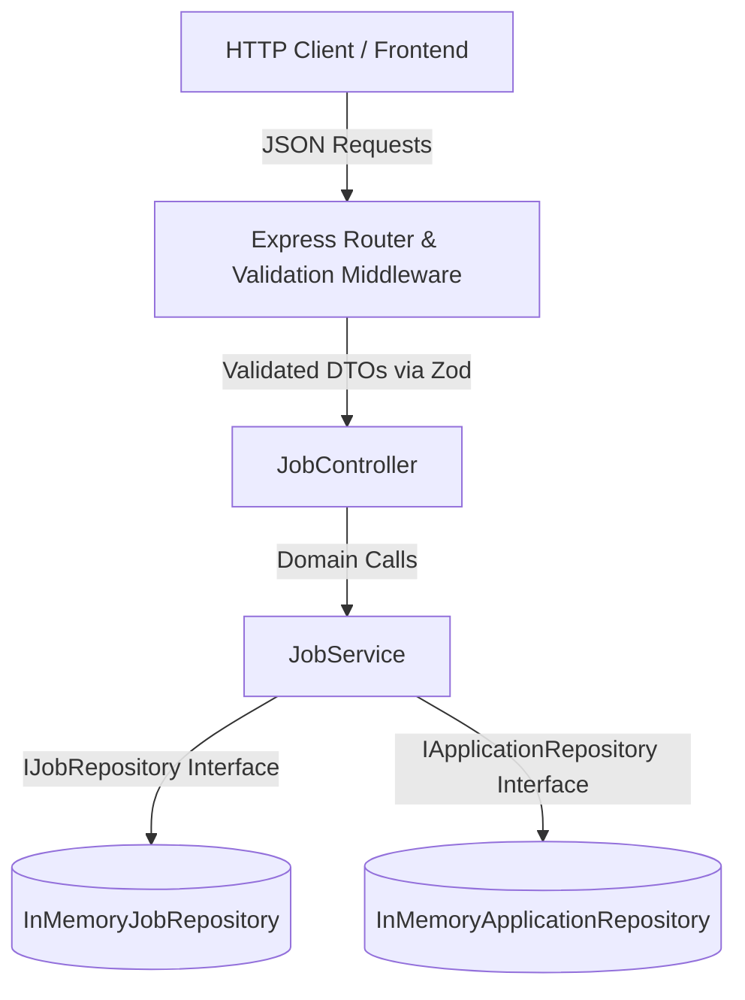
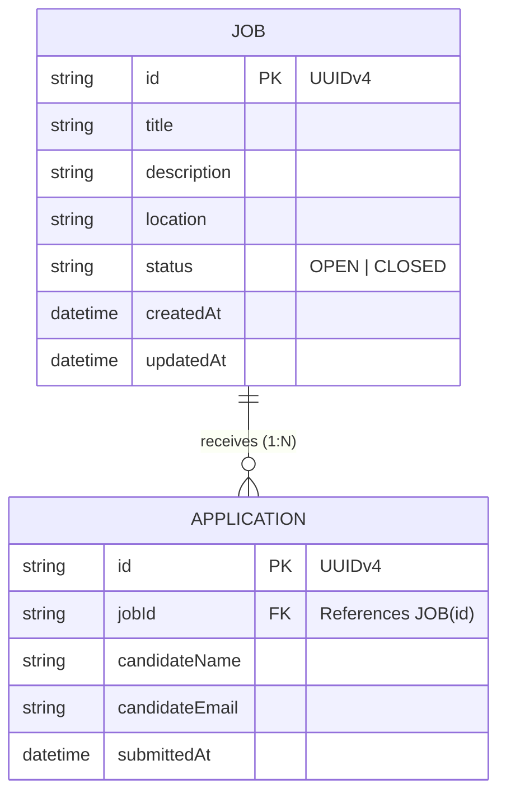
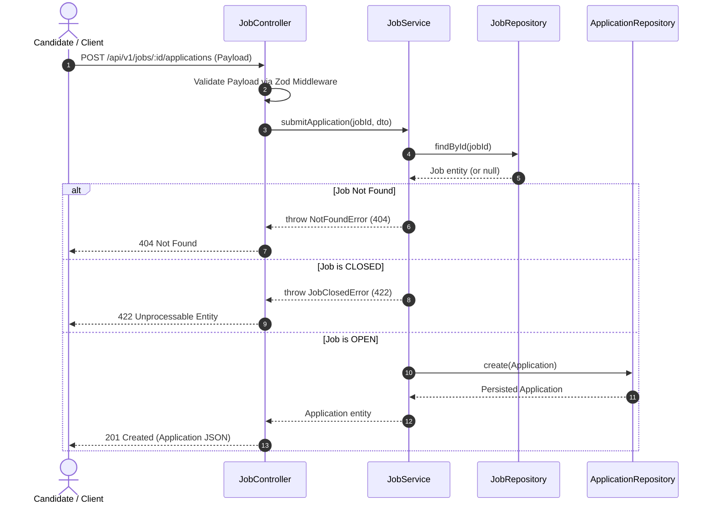

# Job Marketplace API

A RESTful API for a Job Marketplace system built with **Node.js**, **Express**, **TypeScript**, and **Zod**, featuring an in-memory repository architecture and unit tests powered by **Jest** and **SWC**.

---

## 🛠 Tech Stack

- **Runtime:** Node.js (v18+; tested on Node.js v25)
- **Framework:** Express 5
- **Language:** TypeScript 5 / 7
- **Runtime Transpiler & Dev Server:** `tsx` + `nodemon`
- **Validation:** Zod (runtime request schema validation)
- **Testing:** Jest + `@swc/jest` / `ts-jest`

---

## 🏛 Design Overview

The application follows a **3-Tier Layered Architecture** with strict **Separation of Concerns (SoC)** and adheres to the **Dependency Inversion Principle (DIP)**:

### 1. Transport / Controller Layer (`src/controllers`, `src/routes`, `src/middleware`)
- Routes incoming HTTP requests to controller handlers.
- Validates query strings, parameters, and JSON payloads against schema definitions using Zod before invoking domain logic.
- Translates domain responses and custom domain errors into standard HTTP status codes (`200`, `201`, `400`, `404`, `422`).

### 2. Domain / Service Layer (`src/services`, `src/models`)
- Houses pure business logic and enforces domain invariants.
- Guards state transitions (e.g., ensuring applications cannot be submitted to `CLOSED` jobs, and preventing closed jobs from reopening).
- Independent of Express and any HTTP-specific constructs.

### 3. Data Access / Repository Layer (`src/repositories`)
- Abstractions (`IJobRepository`, `IApplicationRepository`) define data access contracts.
- Concrete implementations (`InMemoryJobRepository`, `InMemoryApplicationRepository`) handle thread-safe, in-memory state manipulation using Maps and arrays.
- Decoupled via **Dependency Injection (DI)** so that the storage mechanism can be swapped to an SQL/NoSQL database without modifying the service layer.

---

## 📊 Architecture & Data Flow Diagrams

### 1. System Architecture Diagram



### 2. Entity Relationship Diagram (ERD)



### 3. Application Submission Sequence Diagram



---

## 📁 Project Structure

```text
├── src/
│   ├── app.ts                  # Express application factory & middleware wiring
│   ├── server.ts               # Application entry point & HTTP listener
│   ├── controllers/
│   │   └── job.controller.ts   # Request/response handlers
│   ├── services/
│   │   └── job.service.ts      # Core business logic & rules
│   ├── repositories/
│   │   ├── job.repository.ts          # In-memory storage for jobs
│   │   └── application.repository.ts  # In-memory storage for job applications
│   ├── models/
│   │   ├── job.model.ts        # Data structures and interfaces for Job
│   │   └── application.model.ts# Data structures and interfaces for Application
│   ├── schemas/
│   │   └── job.schema.ts       # Zod validation schemas for requests
│   ├── middleware/
│   │   ├── validate.middleware.ts     # Schema validation middleware
│   │   └── error.middleware.ts        # Centralized global error handling
│   └── errors/
│       └── app-error.ts        # Custom domain error classes
├── tests/
│   └── job.service.test.ts     # Unit test suite for JobService
├── jest.config.js              # Jest configuration with SWC transformer
├── package.json                # Project dependencies and npm scripts
└── tsconfig.json               # TypeScript compiler configuration
```

---

## 🚀 Getting Started

### Prerequisites

- [Node.js](https://nodejs.org/) (v18.x or higher, including Node.js v25)
- [npm](https://www.npmjs.com/) (v9.x or higher)

### Installation

Clone or open the project folder in your terminal, then install dependencies:

```bash
npm install --legacy-peer-deps
```

> **Note:** `--legacy-peer-deps` is used to allow compatibility with the latest TypeScript 7 release while preserving dependency resolution.

---

## 💻 Running the Application

### Development Server

Start the application with hot reloading:

```bash
npm run dev
```

Once running, the server will output:

```text
Job Marketplace API running on http://localhost:3000
```

### Changing the Port

By default, the server runs on port `3000`. You can change the port using the `PORT` environment variable:

**Bash / macOS / Linux:**
```bash
PORT=4000 npm run dev
```

**PowerShell (Windows):**
```powershell
$env:PORT=4000; npm run dev
```

**Command Prompt (Windows):**
```cmd
set PORT=4000 && npm run dev
```

---

## 🧪 Running the Test Cases

The test suite tests the core business logic in `JobService`, including job creation, status transitions, application submissions, and validation/error handling.

### Run All Tests

```bash
npm test
```

### Run a Specific Test File

```bash
npm test job.service.test.ts
```

### Run Tests in Watch Mode

```bash
npm test -- --watch
```

### Run Tests with Coverage Report

```bash
npm test -- --coverage
```

### Summary of Test Cases Covered

The test suite in `tests/job.service.test.ts` validates:

- **Job Lifecycle:**
  - `should create an open job`: Creates a job with default status `OPEN`.
  - `should close an open job`: Transitions a job status from `OPEN` to `CLOSED`.
  - `should throw BadRequestError if closing an already closed job`: Ensures idempotency/valid transition guard.
- **Application Submissions:**
  - `should accept applications for an OPEN job`: Stores application and links it to `jobId`.
  - `should reject applications for a CLOSED job with JobClosedError`: Verifies closed jobs cannot receive applications.
  - `should throw NotFoundError when applying to a non-existent job`: Ensures foreign key check on job ID.

---

## 📖 API Documentation

Base URL: `http://localhost:3000/api/v1/jobs`

### 1. Create a Job
- **Method:** `POST`
- **Path:** `/api/v1/jobs`
- **Request Body:**
  ```json
  {
    "title": "Senior Backend Engineer",
    "description": "Lead API architecture in TypeScript and Node.js",
    "location": "Remote"
  }
  ```
- **Response (201 Created):**
  ```json
  {
    "id": "c6204c31-7b70-49ff-95f7-4eb7d00f7b9e",
    "title": "Senior Backend Engineer",
    "description": "Lead API architecture in TypeScript and Node.js",
    "location": "Remote",
    "status": "OPEN",
    "createdAt": "2026-09-07T03:00:00.000Z",
    "updatedAt": "2026-09-07T03:00:00.000Z"
  }
  ```

---

### 2. List Jobs
- **Method:** `GET`
- **Path:** `/api/v1/jobs`
- **Optional Query Parameter:**
  - `status`: Filter by status (`OPEN` or `CLOSED`), e.g., `/api/v1/jobs?status=OPEN`
- **Response (200 OK):**
  ```json
  {
    "data": [
      {
        "id": "c6204c31-7b70-49ff-95f7-4eb7d00f7b9e",
        "title": "Senior Backend Engineer",
        "description": "Lead API architecture in TypeScript and Node.js",
        "location": "Remote",
        "status": "OPEN",
        "createdAt": "2026-09-07T03:00:00.000Z",
        "updatedAt": "2026-09-07T03:00:00.000Z"
      }
    ],
    "total": 1
  }
  ```

---

### 3. Get Job by ID
- **Method:** `GET`
- **Path:** `/api/v1/jobs/:id`
- **Path Parameter:**
  - `id`: Valid UUID of the job
- **Response (200 OK):**
  ```json
  {
    "id": "c6204c31-7b70-49ff-95f7-4eb7d00f7b9e",
    "title": "Senior Backend Engineer",
    "description": "Lead API architecture in TypeScript and Node.js",
    "location": "Remote",
    "status": "OPEN",
    "createdAt": "2026-09-07T03:00:00.000Z",
    "updatedAt": "2026-09-07T03:00:00.000Z"
  }
  ```
- **Error (404 Not Found):**
  ```json
  {
    "error": "NotFoundError",
    "message": "Job with ID '...' not found"
  }
  ```

---

### 4. Close a Job
- **Method:** `PATCH`
- **Path:** `/api/v1/jobs/:id/close`
- **Response (200 OK):**
  ```json
  {
    "id": "c6204c31-7b70-49ff-95f7-4eb7d00f7b9e",
    "title": "Senior Backend Engineer",
    "description": "Lead API architecture in TypeScript and Node.js",
    "location": "Remote",
    "status": "CLOSED",
    "createdAt": "2026-09-07T03:00:00.000Z",
    "updatedAt": "2026-09-07T03:05:00.000Z"
  }
  ```
- **Error (400 Bad Request):** If the job is already `CLOSED`.

---

### 5. Submit an Application
- **Method:** `POST`
- **Path:** `/api/v1/jobs/:id/applications`
- **Path Parameter:**
  - `id`: Valid UUID of the job
- **Request Body:**
  ```json
  {
    "candidateName": "Jane Doe",
    "candidateEmail": "jane.doe@example.com"
  }
  ```
- **Response (201 Created):**
  ```json
  {
    "id": "e4b6c934-2978-4395-8121-65123d463b21",
    "jobId": "c6204c31-7b70-49ff-95f7-4eb7d00f7b9e",
    "candidateName": "Jane Doe",
    "candidateEmail": "jane.doe@example.com",
    "submittedAt": "2026-09-07T03:10:00.000Z"
  }
  ```
- **Error (422 Unprocessable Entity):** If the job is `CLOSED`.
- **Error (404 Not Found):** If the job does not exist.

---

### 6. List Applications for a Job
- **Method:** `GET`
- **Path:** `/api/v1/jobs/:id/applications`
- **Path Parameter:**
  - `id`: Valid UUID of the job
- **Response (200 OK):**
  ```json
  {
    "data": [
      {
        "id": "e4b6c934-2978-4395-8121-65123d463b21",
        "jobId": "c6204c31-7b70-49ff-95f7-4eb7d00f7b9e",
        "candidateName": "Jane Doe",
        "candidateEmail": "jane.doe@example.com",
        "submittedAt": "2026-09-07T03:10:00.000Z"
      }
    ],
    "total": 1
  }
  ```

---

## 🛡 Business Rules & Error Handling

1. **Default Job State:** Newly posted jobs initialize with status `OPEN`.
2. **One-Way Terminal State:** Closing a job is a terminal operation. A `CLOSED` job cannot accept applications, nor can it be reopened.
3. **Application Invariant:** The service verifies both job existence and status before persisting an application. If `CLOSED`, it rejects the request with `JobClosedError` (`422 Unprocessable Entity`).
4. **Idempotent Closure Guard:** Attempting to close a job that is already `CLOSED` raises a `BadRequestError` (`400 Bad Request`).
5. **Strict Boundary Validation:** Incoming JSON bodies and query parameters are pre-screened with Zod. Invalid payloads return HTTP `400` with detailed error fields before reaching service handlers.
6. **Centralized Error Handling:** Custom domain errors subclassing `AppError` map automatically to standard HTTP status codes.

---

## 💡 Assumptions

1. **Storage Persistence Lifecycle:** Data is stored in memory (`Map` and native arrays) and is intended for local execution and automated testing. In-memory data resets upon server restart.
2. **Authentication & Authorization:** In alignment with project specifications, authentication (e.g., JWT, OAuth2) and role-based access control (RBAC separating Recruiters from Candidates) were intentionally omitted.
3. **Job Closure Immutability:** Once a job is marked `CLOSED`, it represents an expired listing and cannot be reverted back to `OPEN`. Existing applications remain viewable by recruiters.
4. **Identity Generation:** Entities utilize cryptographically secure `UUIDv4` strings for IDs, eliminating ID guessing and auto-increment race conditions.
5. **Application Submissions:** Candidates may submit multiple applications to different jobs. Candidate emails are normalized to lowercase to maintain data consistency.

---

## 🚀 What I'd Improve with More Time

Given additional time to take this application toward enterprise production readiness, the following enhancements would be prioritized:

### 1. Persistent Storage & ACID Concurrency Control
- **Database Integration:** Replace in-memory repositories with PostgreSQL using Prisma ORM or Kysely.
- **Race Condition Prevention:** Under high concurrency, an applicant might submit an application while an admin closes the job simultaneously. Using SQL transactions with row-level locking (`SELECT ... FOR UPDATE`) or Optimistic Concurrency Control (version column) guarantees that an application cannot be committed against a concurrently closed job.

### 2. Scalability & Pagination
- Implement cursor-based pagination (e.g., `?cursor=xyz&limit=20`) for `GET /api/v1/jobs` and `GET /api/v1/jobs/:id/applications` to avoid large in-memory memory spikes on high-volume datasets.

### 3. Idempotency & Deduplication
- **Duplicate Protection:** Enforce a composite unique constraint (`jobId`, `candidateEmail`) or use Redis-based idempotency keys on `POST /applications` to protect against duplicate double-clicks or client retries.

### 4. Interactive Documentation & E2E Integration Testing
- Integrate Swagger / OpenAPI documentation (via `tsoa` or `swagger-ui-express`) so consumers can test and inspect schemas interactively.
- Add an end-to-end integration test suite using Supertest to test route handlers and HTTP status codes alongside existing unit tests.

### 5. Production Observability & Async Processing
- Add structured JSON logging (via Pino or Winston) and attach correlation IDs (`x-request-id`) across middleware for distributed tracing.
- Offload non-critical side effects (e.g., sending email confirmations to candidates) to an asynchronous background job queue (e.g., BullMQ with Redis).
